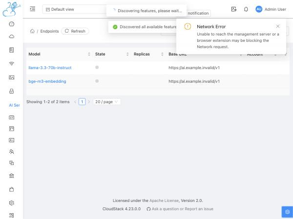
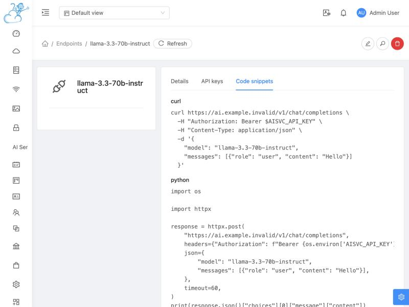
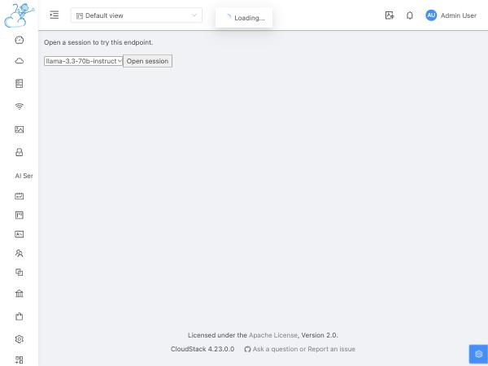
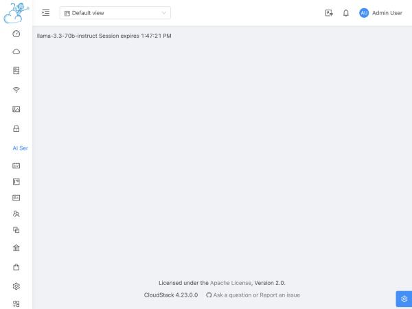
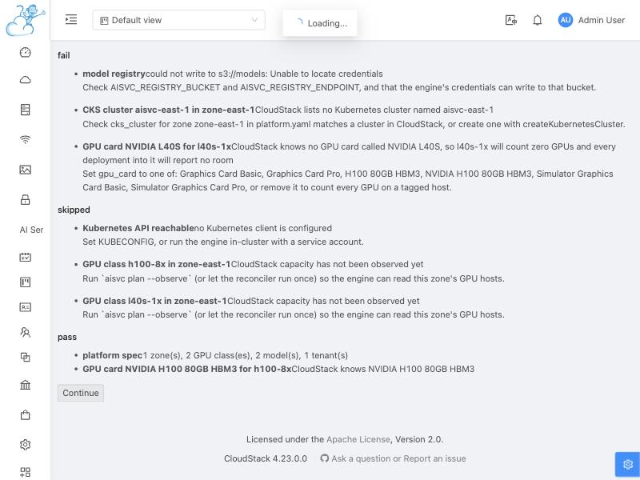

# The AI Services UI section

What a tenant and an operator actually see, screen by screen.

This describes `ui/src/config/section/aiservices.js` and the eleven Vue
views beside it. For how to install the section into a CloudStack `ui/`
tree, see [installation.md](installation.md); for why it is built the
way it is, [ui/README.md](../ui/README.md).

## The one rule that explains the layout

**Nothing here is configured on or off.** Each screen declares the
command it needs:

```js
{ name: 'aiplayground', permission: ['createAiPlaygroundSession'], … }
```

CloudStack drops any route whose `permission` is missing from the
account's own `listApis` answer, and then drops a section with no
children. So the screens a person sees follow the commands the plugin
registered for their role — and the whole Tier 2 group appears and
disappears with `ai.services.v2.enabled` alone, with nothing in the UI
to switch.

That also means the UI can never offer something the API will refuse:
the same role check decides both.

## What each role sees

Nineteen screens. Eleven are visible to anyone with a role, and the
rest are gated:

| Screens | Who |
| --- | --- |
| Model catalog, Endpoints, Playground, Generation profiles, Effective parameters, Usage, Adapters, Batches, Certificates, Private endpoints, Guardrails | anyone, filtered to what they own |
| Hugging Face, Registry, Rollouts, Activity | admin or domain admin |
| Setup, GPU capacity, Fleet health, Serving profiles | root admin |

A tenant is not shown an empty operator screen; the route is not there
at all. Typing its URL gives a 404 rather than a refusal, which is
CloudStack's own behaviour for a route it did not register.

## The tenant's screens

### Model catalog

What this provider sells: the models, what each is for, its licence and
its price tier.


The catalogue is the spec's `models:` list filtered by visibility, so a
reseller's tenants see their reseller's selection. Licence is shown
because several open-weight licences carry use restrictions, and a
tenant choosing a model is choosing its terms.

### Endpoints

The OpenAI-compatible base URL per model, with an **API keys** tab and a
**Snippets** tab on each.



Keys are scoped: a key may name the models it may use, the CIDRs it may
be called from, and when it expires. The secret is shown once, on
creation, because keys are stored as salted hashes.



The snippets tab carries copy-ready calls — curl, plain Python, and the
OpenAI clients for Python and JavaScript — rendered by the engine and
delivered with the endpoint. They are rendered there rather than in the
browser so there is one implementation of "how you call this", and they
read the key from the environment rather than carrying one: a snippet
gets copied into tickets and chats, where a live key would outlive any
session.

### Playground

A fifteen-minute, model-scoped session for trying an endpoint without
putting a real key in a browser.



Pick a model and open a session. Nothing is minted until you ask: a
session key is a credential, and issuing one because somebody opened a
page starts its expiry running against a person who is only reading.



The session shows what it is for and when it ends. **The key itself is
never rendered** — it is short-lived, but this screen gets demonstrated
and screenshotted, and a credential on screen is a credential in
somebody's slide deck.

### Effective parameters

Every generation parameter's resolved value *and the level that set it*.

A resolved value alone tells a tenant nothing; the useful question is
always "why is it that, and may I change it". So each row carries its
source — platform, model default, domain, account, deployment, key or
the request — and marks anything locked above them.

This reads through the same `aisvc.profiles.resolve()` the gateway
enforces with, so the screen cannot disagree with what a request
actually does.

### Generation profiles, usage and budgets

Generation profiles are a tenant's own tuning, bound at a scope they
are allowed to write. Usage shows tokens and GPU-hours with a budgets
tab beside it; a tenant may read their budget and not set it, since an
account able to raise its own ceiling has no ceiling.

### Tier 2: adapters, batches, certificates, private endpoints, guardrails

Present only when `ai.services.v2.enabled` is on. LoRA adapters a
tenant brings; batch jobs; TLS certificates for a custom domain; a
private endpoint on their own network; and guardrail profiles, which a
tenant may tighten for themselves and never loosen below what is locked
above them.

A guardrail profile has a **Checks** tab rather than a checks row: the
engine keys them by name, the plugin carries them as a named list, and
CloudStack's detail view prints a value rather than rendering one, so a
list there reads `[object Object]`. The tab calls out anything
`locked`, which is the thing being sold — a school sets education-safe
on their domain precisely so an account beneath cannot relax it, and a
tenant looking at the profile screening them should not have to infer
that.

## The operator's screens

### Setup

A preflight wizard: what CloudStack must have before anything can be
deployed, each check passing, failing or skipped with the remedy named.



Grouped by outcome, failures first, because a wizard is read top down
and what blocks you should not be below what did not. **Continue is
disabled while anything failed** — and also while the checks could not
be read at all, which is not the same as nothing having failed.

Every remedy is the engine's own sentence, naming the setting or the
command that fixes it: `gpu_card` has to match a card CloudStack knows,
so the check that finds it does not lists the ones it does.

### GPU capacity

A heatmap of GPU capacity by zone and class, reading observed state —
what CloudStack reports — rather than anything the engine stores, so it
cannot drift. Allocated and unhealthy are not reported directly; they
are derived from the totals beside them, in one place.

The status a cell takes is what carries its colour, and unhealthy
outranks busy, so failing hardware cannot hide behind a quiet class.

### Fleet health · not built

Declared, and it has no data source. It renders hosts with their
template, driver and drift from `listAiGpuCapacity`, which answers per
GPU *class* — zone, class, node and GPU counts — and the engine has no
host-level route at all. The screen needs one before it can show
anything; it is listed here rather than quietly omitted.

### Hugging Face

Search the Hub and see, before mirroring, whether a model can be
deployed here at all: its licence against the allow-list, whether it
carries pickle weights, whether it needs `trust_remote_code`.

It does not search until asked. Searching on load would hit the Hub for
every operator who opened the screen.

### Registry, rollouts and activity

What has been mirrored, with an evaluations tab showing the gate result
rather than a bare score; blue/green rollouts with their traffic
weights, promote and rollback; and the reconciler's runs with the
actions each took.

## Two things worth knowing

**Every screen is also CloudMonkey and Terraform.** The section's
config names API commands and nothing else, so anything doable here is
doable from a script — SPEC section 9 requires it, and the config shape
is what keeps it true.

**Most screens are config, not code.** Eight of nineteen are declared
entirely in `aiservices.js`, and CloudStack builds the list, the detail
view, search, pagination, async job notifications and role-based action
visibility from that. Eleven are Vue components, because a table cannot
express a wizard, a heatmap, a chat transcript, a resolved-parameter
table or a Hub search.

## When something goes wrong

Every screen tells you which of three things happened, because they
used to look identical — blank:

- **Could not load**, in the engine's own words.
- **Nothing to show**, which is a different thing and says so.
- The data.


That sentence is the point of the whole chain. The engine answers in
RFC 9457 problem JSON so its caller can explain itself, the plugin
appends the detail to the status, and CloudStack carries it to the
browser as `errortext`. Read the wrong field and all of it is wasted:
axios's own `message` is *"Request failed with status code 534"*, which
names no remedy at all — and that is exactly what every screen showed,
because CloudStack wraps a refusal one level deeper than it looks:

```json
{"listaigpucapacityresponse": {"errorcode": 534, "errortext": "…"}}
```

`ui/src/utils/errors.js` reads it out of that wrapper. Nine screens use
it; before it existed one screen tried and got the depth wrong, and the
other eight emptied their list and said nothing, so "could not reach the
engine" and "you have no keys yet" were the same blank panel.

None of them leaves an unhandled promise rejection either. They used
to: nine of the eleven views called the API with no `catch`, so a
refusal put the reason in the browser console, where nobody is looking.
